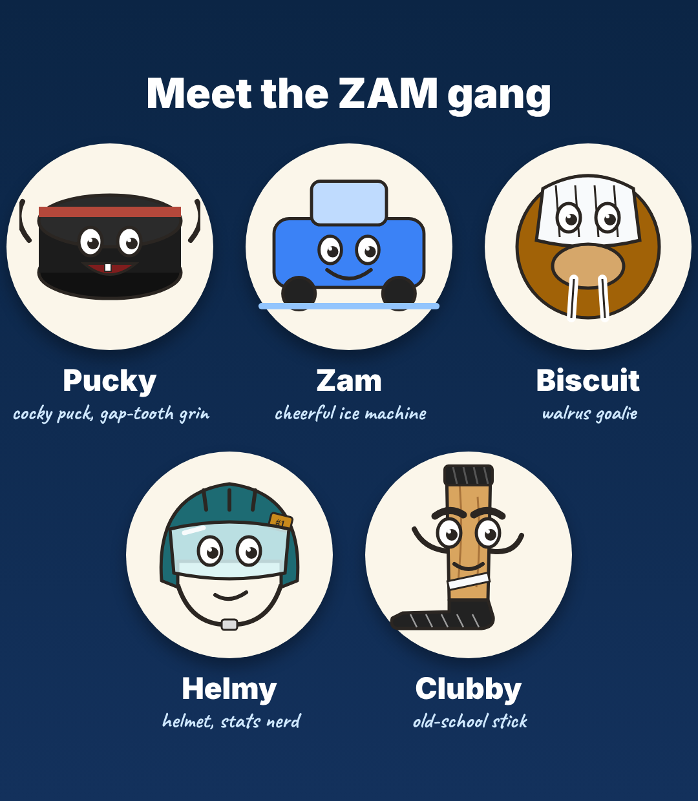

# ZAM – NHL week in under a minute

Faceless YouTube Shorts channel hosted by the ZAM gang: **Zam** (ice machine), **Pucky** (puck), **Biscuit** (walrus goalie), **Helmy** (helmet) and **Clubby** (stick).

* Production rules: [`CLAUDE.md`](CLAUDE.md)
* Video engine: Remotion in `video/` (`cd video && npm ci && npx remotion studio`)
* Voice: ElevenLabs via `scripts/tts.py` (API key as a network secret on the cloud environment – never commit it)

Reusable building blocks (paper kit, banana effects, Show, Bouncy pattern, brand intro/outro pattern) come from the AI Bounce project and will be adapted to the hockey cast.
